# Indonesian Tweet Sentiment Classification

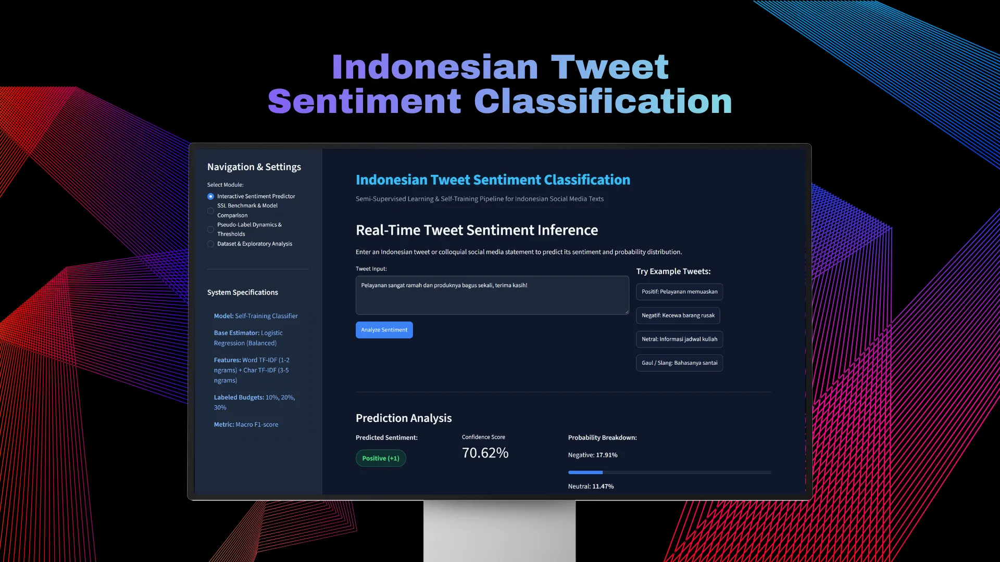


## Project Overview

Indonesian Tweet Sentiment Classification is an empirical machine learning study and interactive analytics application investigating whether semi-supervised Self-Training can improve three-class sentiment classification (`Negative`, `Neutral`, `Positive`) on colloquial Indonesian tweets under constrained manual annotation budgets. Using a curated corpus of Indonesian Twitter posts, the repository implements a leakage-free data preparation pipeline, a hybrid word- and character-level TF-IDF feature representation (`97,183` dimensions), multi-seed supervised and semi-supervised benchmarking across `10%`, `20%`, and `30%` labeled training budgets, confidence threshold sensitivity analysis, a CLI inference tool, and a multi-module Streamlit dashboard.

## Problem Statement & Objectives

Acquiring reliable human sentiment annotations for informal Indonesian social media text is expensive and slow due to slang (*bahasa gaul*), regional loanwords, pervasive abbreviations, and subtle sarcasm. Purely supervised classifiers struggle when only a small fraction of incoming social media streams can be labeled, while abundant unlabeled tweets remain underutilized. This project evaluates how effectively iterative pseudo-labeling bridges that annotation gap without introducing text leakage or noise amplification.

- Benchmark Semi-Supervised Self-Training (`SelfTrainingClassifier`) against a class-balanced Logistic Regression Supervised Baseline across `10%`, `20%`, and `30%` labeled training budgets over three fixed random seeds (`42`, `123`, `456`), alongside a `100%` labeled Supervised Oracle upper bound.
- Enforce zero text leakage through normalized text deduplication and conflicting-label isolation prior to stratified train/test partitioning.
- Preserve Indonesian morphological and informal spelling cues using a dual-stream `FeatureUnion` combining word n-grams `(1, 2)` and character n-grams `(3, 5)`.
- Quantify pseudo-label volume, class distribution, ground-truth pseudo-label accuracy, and confidence threshold trade-offs across `0.70` to `0.90`.
- Deliver modular reproducible scripts ([src/](src/)), quantitative CSV/Markdown tables ([tables/](tables/)), high-resolution figures ([figures/](figures/)), and an interactive Streamlit dashboard ([streamlit/app.py](streamlit/app.py)).

## Data & Input Sources

The primary corpus is a tab-delimited Indonesian Twitter sentiment file stored at [dataset/original/Indonesian_Sentiment_Twitter_Dataset_Labeled.csv](dataset/original/Indonesian_Sentiment_Twitter_Dataset_Labeled.csv). After auditing duplicates and inter-annotator label conflicts, deterministic `80/20` stratified partitions are persisted in [dataset/train_set.csv](dataset/train_set.csv) and [dataset/test_set.csv](dataset/test_set.csv).

| Attribute | Details |
| :--- | :--- |
| **Dataset / Input Source** | Indonesian Sentiment Twitter Dataset Labeled |
| **Source** | [dataset/original/Indonesian_Sentiment_Twitter_Dataset_Labeled.csv](dataset/original/Indonesian_Sentiment_Twitter_Dataset_Labeled.csv) |
| **Format** | Tab-delimited TSV stored with `.csv` extension (UTF-8 / Latin-1 fallback); derived CSV splits |
| **Raw Samples / Records** | `10,806` rows (`0` missing values, `549` exact duplicate rows, `156` conflicting text groups across `422` rows) |
| **Clean Deduplicated Samples** | `9,926` unique normalized tweets (`7,940` train / `1,986` holdout test) |
| **Features / Input Shape** | Raw `Tweet` string (`2`–`140` characters, `1`–`28` words); `97,183` sparse TF-IDF features after fitting |
| **Target / Label** | `sentimen` (`-1`: Negative `26.19%`, `0`: Neutral `49.84%`, `1`: Positive `23.97%` in clean corpus) |

## Data Preprocessing & Feature Engineering

Because repeated tweets and conflicting labels in raw social media datasets cause severe train-test snooping and label noise, [src/data_preparation.py](src/data_preparation.py) applies normalized group-level cleaning before splitting, and [src/train.py](src/train.py) fits a hybrid TF-IDF `FeatureUnion` strictly on the training partition. Stemming and aggressive stopword removal are intentionally omitted so Indonesian negation markers (*tidak*, *tak*, *bukan*, *jangan*), affixes, and slang abbreviations remain intact.

| Transformation Stage | Input | Output / Effect |
| :--- | :--- | :--- |
| **Text Normalization for Dedup** | Raw `Tweet` strings | Lowercased, whitespace-collapsed `norm_text` key preserving punctuation and tokens |
| **Conflict Isolation** | `10,806` raw rows | Excludes `156` conflicting normalized text groups (`422` rows) in primary benchmark |
| **Deduplication** | Remaining consistent rows | `9,926` unique normalized tweets preventing sample weight inflation |
| **Stratified Split** | `9,926` clean tweets | `7,940` train (`80%`) and `1,986` sealed holdout test (`20%`) with zero text overlap |
| **Label Remapping** | `{-1, 0, 1}` labels | Mapped to `{0, 1, 2}` so `-1` is reserved exclusively for unlabeled SSL samples |
| **Hybrid TF-IDF `FeatureUnion`** | `Tweet` text arrays | Concatenated Word TF-IDF `(1, 2)` and Char TF-IDF `(3, 5)` (`min_df=2`, `sublinear_tf=True`) |

1. Load tab-delimited tweet records and validate `sentimen` and `Tweet` schema columns.
2. Generate `norm_text` via lowercasing, whitespace collapsing, and boundary trimming.
3. Isolate and remove all normalized text groups carrying multiple distinct sentiment labels (with a separate majority-vote sensitivity dataset tested in parallel).
4. Deduplicate remaining records by `norm_text` and execute a stratified `80/20` train/test split (`random_state=42`).
5. Mask `90%`, `80%`, or `70%` of training labels as `-1` via stratified sampling to simulate `10%`, `20%`, and `30%` labeled budgets, then fit the `97,183`-dimensional TF-IDF `FeatureUnion` strictly on training tweets.

## Tech Stack

| Category | Technology | Purpose |
| :--- | :--- | :--- |
| **Language** | Python | Core scripting, modeling, evaluation, and dashboard runtime |
| **ML Framework** | Scikit-Learn | TF-IDF `FeatureUnion`, `LogisticRegression`, `SelfTrainingClassifier`, metrics |
| **Data Processing** | Pandas, NumPy | TSV/CSV ingestion, deduplication audit, stratified budget masking |
| **Serialization** | Joblib | Persisting the best trained model bundle and fitted vectorizer |
| **Visualization** | Matplotlib, Seaborn | Generating 300 DPI EDA, confusion matrix, and benchmark plots |
| **Interactive UI** | Streamlit | Four-module dark-mode web dashboard for inference and diagnostics |
| **Reporting** | Tabulate | Exporting formatted Markdown experiment summary tables |

## Machine Learning Approach

The project formulates Indonesian tweet sentiment analysis as a three-class **Semi-Supervised Learning** problem under scarce labeled data budgets. A calibrated linear baseline is compared directly against iterative self-training across identical feature matrices and holdout test sets.

| Attribute | Implementation |
| :--- | :--- |
| **Learning Paradigm** | Semi-Supervised Learning (with Supervised Baseline and 100% Oracle reference) |
| **Problem Domain** | Natural Language Processing / Indonesian Social Media Text |
| **ML Task** | Multi-Class Sentiment Classification (`Negative`, `Neutral`, `Positive`) |
| **Input Representation** | Hybrid Word `(1, 2)` + Character `(3, 5)` TF-IDF sparse matrix (`97,183` features) |
| **Target / Output** | Discrete sentiment polarity (`-1`, `0`, `1`) and calibrated class probabilities |
| **Primary Metric** | Macro F1-Score (unweighted class mean to counter `49.84%` Neutral majority) |

## Model Overview

All primary experiments use multiclass `LogisticRegression` as both the standalone supervised baseline and the base probabilistic estimator inside `SelfTrainingClassifier`. Model weights are trained from scratch on the Indonesian Twitter training partition rather than loaded from an external pretrained checkpoint.

| Attribute | Details |
| :--- | :--- |
| **Primary Model** | `SelfTrainingClassifier` wrapping `LogisticRegression` |
| **Baseline & Upper Bound** | Standalone `LogisticRegression` (`10%`/`20%`/`30%` budgets and `100%` Oracle) |
| **Model Family** | Regularized Multinomial Linear Classifier with Iterative Pseudo-Labeling |
| **Framework** | Scikit-Learn |
| **Input** | `97,183`-dimensional sparse TF-IDF vector |
| **Output** | Predicted sentiment class (`0`, `1`, `2` mapped back to `-1`, `0`, `1`) + `predict_proba` |
| **Pretrained Status** | Trained from scratch on project splits (no external pretrained weights used) |

## ML Workflow

1. **Data Audit & Leakage-Free Splitting ([src/data_preparation.py](src/data_preparation.py))**: Inspect the `10,806` raw tweets, remove `156` conflicting text groups (`422` rows), deduplicate to `9,926` unique texts, and generate stratified `80/20` splits ([dataset/train_set.csv](dataset/train_set.csv) and [dataset/test_set.csv](dataset/test_set.csv)).
2. **Feature Extraction ([src/train.py](src/train.py))**: Fit `FeatureUnion` (word 1–2 n-grams and char 3–5 n-grams) on the `7,940` training tweets and transform the `1,986` holdout test tweets.
3. **Budget Simulation & Multi-Seed Training ([src/train.py](src/train.py))**: Evaluate Supervised Baseline vs. Self-Training across `10%` (`794`), `20%` (`1,588`), and `30%` (`2,382`) labeled budgets over seeds `42`, `123`, and `456`, plus the `100%` (`7,940`) Oracle.
4. **Sensitivity Experiments ([src/train.py](src/train.py))**: Run confidence threshold sweeps (`0.70`–`0.90`) at the `20%` budget (`seed=42`) and a secondary majority-vote conflict-handling experiment.
5. **Evaluation & Visualization ([src/evaluate.py](src/evaluate.py), [final_report.md](final_report.md))**: Export CSV/Markdown tables to [tables/](tables/) and generate 10 publication-grade 300 DPI diagnostic figures in [figures/](figures/).
6. **Model Persistence & Inference ([src/predict.py](src/predict.py), [streamlit/app.py](streamlit/app.py))**: Persist the top-performing model bundle to [models/best_model.joblib](models/best_model.joblib) for CLI batch/single predictions and interactive exploration in Streamlit.

## ML Pipeline Architecture

The end-to-end architecture separates raw corpus auditing and zero-leakage splitting from feature extraction, parallel supervised/self-training evaluation, artifact export, and downstream inference. Both the CLI predictor and Streamlit application consume the serialized `best_model.joblib` bundle containing the fitted `FeatureUnion` and trained `SelfTrainingClassifier`.

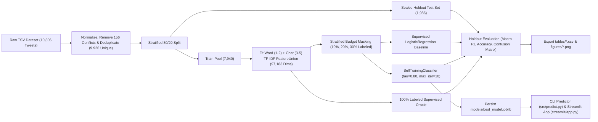

## Model Training & Configuration

Training is performed in [src/train.py](src/train.py) using L-BFGS multinomial optimization with balanced class weights (`class_weight="balanced"`) to mitigate class imbalance toward the `Neutral` class. During Self-Training, unlabeled samples (`y = -1`) exceeding the confidence threshold `threshold=0.80` are iteratively promoted into the labeled pool for up to `10` iterations, and hidden ground-truth labels are strictly used post-hoc to measure pseudo-label accuracy.

| Configuration Parameter | Value | Description |
| :--- | :--- | :--- |
| **Base Estimator** | `LogisticRegression` | Multinomial linear classifier with `predict_proba` |
| **Solver & Iterations** | `solver="lbfgs"`, `max_iter=1000` | Convex optimization for sparse high-dimensional TF-IDF features |
| **Regularization (`C`)** | `1.0` | Inverse L2 regularization strength |
| **Class Weighting** | `"balanced"` | Adjusts weights inversely proportional to class frequencies |
| **Word TF-IDF** | `ngram_range=(1, 2)`, `min_df=2`, `sublinear_tf=True` | Token pattern `(?u)\b\w+\b` capturing lexical phrases and negations |
| **Char TF-IDF** | `analyzer="char"`, `ngram_range=(3, 5)`, `min_df=2`, `sublinear_tf=True` | Subword features capturing Indonesian slang, typos, and affixes |
| **SSL Meta-Estimator** | `SelfTrainingClassifier` | Iterative pseudo-labeling over masked unlabeled training rows |
| **Default SSL Threshold & Cap** | `threshold=0.80`, `max_iter=10` | Minimum predicted probability required to accept pseudo-labels |
| **Budgets & Random Seeds** | Budgets `0.10, 0.20, 0.30`; Seeds `42, 123, 456` | Multi-seed replication plus `100%` Oracle (`seed=42`) |

```python
base_clf = LogisticRegression(
    C=1.0,
    class_weight="balanced",
    max_iter=1000,
    random_state=seed,
    solver="lbfgs",
)
st_clf = SelfTrainingClassifier(
    estimator=base_clf,
    threshold=0.80,
    max_iter=10,
    verbose=False,
)
```

## Hyperparameter Tuning & Experiment Tracking

Rather than automated grid search over `C`, [src/train.py](src/train.py) executes two structured sensitivity studies at the `20%` labeled budget (`seed=42`): a confidence threshold sweep across `{0.70, 0.75, 0.80, 0.85, 0.90}` logged to [tables/threshold_sensitivity.csv](tables/threshold_sensitivity.csv), and a conflict-resolution comparison logged to [tables/secondary_conflict_experiment.csv](tables/secondary_conflict_experiment.csv).

| Threshold ($\tau$) | Test Macro F1 | Test Accuracy | Pseudo-Labels Added | Pseudo-Label Accuracy | Iterations | Pseudo Class Breakdown (Neg / Neu / Pos) |
| :---: | :---: | :---: | :---: | :---: | :---: | :---: |
| `0.70` | **0.5322** | 0.5665 | 733 | 77.76% | 10 | 204 / 367 / 162 |
| `0.75` | 0.5317 | 0.5710 | 159 | 83.02% | 10 | 6 / 84 / 69 |
| `0.80` | 0.5320 | **0.5725** | 23 | **95.65%** | 4 | 0 / 9 / 14 |
| `0.85` | 0.5272 | 0.5690 | 6 | 83.33% | 3 | 0 / 3 / 3 |
| `0.90` | 0.5282 | 0.5695 | 1 | 0.00% | 2 | 0 / 0 / 1 |

## Model Comparison & Selection

Models are compared on the identical sealed holdout test set (`N = 1,986`) across all budgets and seeds in [tables/budget_experiments_summary.csv](tables/budget_experiments_summary.csv) and [tables/detailed_seed_results.csv](tables/detailed_seed_results.csv). The persisted [models/best_model.joblib](models/best_model.joblib) bundle stores the highest-scoring semi-supervised `SelfTrainingClassifier` run selected during the primary benchmark.

| Budget | Model | Mean Macro F1 | Mean Accuracy | Mean Weighted F1 | Mean Pseudo Added | Mean Pseudo Acc | Mean Train Time |
| :--- | :--- | :---: | :---: | :---: | :---: | :---: | :---: |
| `10%` (`N=794`) | Supervised Baseline | 0.4863 ± 0.0046 | 0.5462 ± 0.0053 | 0.5290 ± 0.0042 | — | — | 0.69s |
| `10%` (`N=794`) | Self-Training SSL | **0.4866 ± 0.0050** | **0.5465 ± 0.0059** | **0.5294 ± 0.0047** | 2 | 58.33% | 1.84s |
| `20%` (`N=1,588`) | Supervised Baseline | 0.5294 ± 0.0023 | 0.5700 ± 0.0036 | 0.5628 ± 0.0023 | — | — | 0.81s |
| `20%` (`N=1,588`) | Self-Training SSL | **0.5330 ± 0.0054** | **0.5727 ± 0.0058** | **0.5660 ± 0.0051** | 43 | 86.54% | 5.41s |
| `30%` (`N=2,382`) | Supervised Baseline | 0.5478 ± 0.0063 | 0.5812 ± 0.0063 | 0.5772 ± 0.0059 | — | — | 0.97s |
| `30%` (`N=2,382`) | Self-Training SSL | **0.5510 ± 0.0060** | **0.5843 ± 0.0058** | **0.5803 ± 0.0059** | 86 | 86.01% | 9.38s |
| `100%` (`N=7,940`) | Supervised Oracle | **0.5990** | **0.6198** | **0.6213** | — | — | 2.76s |

## Model Artifacts & Checkpoints

All trained artifacts, data splits, quantitative tables, and figures generated by [src/train.py](src/train.py) and [src/evaluate.py](src/evaluate.py) are preserved in the repository. Note that [src/predict.py](src/predict.py) defaults to `outputs/models/best_model.joblib`, so pass `--model models/best_model.joblib` when running against the repository root artifact.

| Artifact | Format | Purpose | Location |
| :--- | :--- | :--- | :--- |
| **Best Self-Training Bundle** | `.joblib` | Project-trained `SelfTrainingClassifier`, fitted `FeatureUnion`, and metadata | [models/best_model.joblib](models/best_model.joblib) |
| **Stratified Splits** | `.csv` | Leakage-free `80/20` train (`7,940`) and holdout test (`1,986`) records | [dataset/train_set.csv](dataset/train_set.csv), [dataset/test_set.csv](dataset/test_set.csv) |
| **Benchmark & Seed Logs** | `.csv` | Aggregated budget metrics, per-seed confusion matrices, and sensitivity logs | [tables/budget_experiments_summary.csv](tables/budget_experiments_summary.csv), [tables/detailed_seed_results.csv](tables/detailed_seed_results.csv) |
| **Sensitivity Tables** | `.csv` | Threshold sweep (`0.70`–`0.90`) and majority-vote conflict results | [tables/threshold_sensitivity.csv](tables/threshold_sensitivity.csv), [tables/secondary_conflict_experiment.csv](tables/secondary_conflict_experiment.csv) |
| **Diagnostic Figures** | `.png` | Ten 300 DPI EDA, performance, confusion matrix, and dynamics charts | [figures/](figures/) |

## Model Evaluation & Results

All metrics are computed strictly on the sealed `1,986`-tweet holdout test set (`520` Negative, `990` Neutral, `476` Positive). Because the `Neutral` class constitutes `49.84%` of the clean corpus, Macro F1-Score serves as the primary evaluation metric alongside overall Accuracy, Weighted F1-Score, per-class F1 breakdown, and hidden ground-truth accuracy of accepted pseudo-labels.

| Evaluation Slice (`20%` Budget, `Seed 42` & `100%` Oracle) | Negative F1 | Neutral F1 | Positive F1 | Macro F1 | Test Accuracy |
| :--- | :---: | :---: | :---: | :---: | :---: |
| **Supervised Baseline (`20%`, `Seed 42`)** | 0.4324 | 0.6667 | 0.4824 | 0.5272 | 56.90% |
| **Self-Training SSL (`20%`, `Seed 42`, $\tau=0.80$)** | **0.4392** | **0.6676** | **0.4891** | **0.5320** | **57.25%** |
| **Supervised Oracle (`100%`, `Seed 42`)** | 0.5273 | 0.6914 | 0.5782 | 0.5990 | 61.98% |

- **Moderate-Budget SSL Gains:** At `20%` and `30%` labeled budgets, Self-Training outperformed the Supervised Baseline in mean Macro F1 (`0.5330` vs. `0.5294` at `20%`; `0.5510` vs. `0.5478` at `30%`) while maintaining `86.54%` and `86.01%` ground-truth accuracy on accepted pseudo-labels.
- **Ultra-Low Budget Starvation (`10%`):** With only `794` labeled tweets, calibrated probabilities rarely exceeded `0.80` (averaging `1.67` pseudo-labels per run), resulting in near-identical test performance (`0.4866` vs. `0.4863` Macro F1).
- **Conflict Resolution Sensitivity:** Resolving the `156` conflicting texts via majority vote at the `20%` budget (`seed=42`) preserved the SSL advantage (`0.5375` vs. `0.5340` Macro F1).
- **Primary Error Mode:** Across `20%` budget confusion matrices (`seed=42`), `46.73%` of true Negative tweets and `38.66%`–`38.87%` of true Positive tweets were misclassified as Neutral, reflecting colloquial understatement and sarcastic phrasing not fully separable by linear TF-IDF weights.

## Results Visualization & Preview

### 1. Real-Time Tweet Sentiment Inference Module
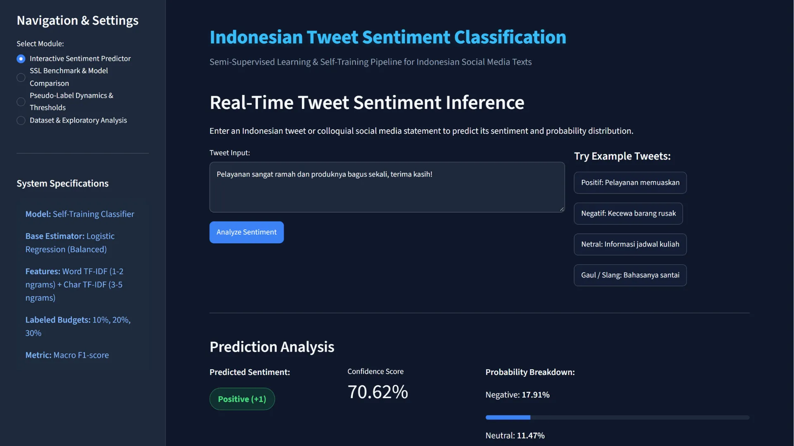
The interactive Streamlit inference module accepts custom or preset Indonesian tweets and outputs the predicted sentiment badge, top-class confidence score, and per-class probability bars from `best_model.joblib`. For the sample positive service tweet, the classifier predicts `Positive (+1)` at `70.62%` confidence (`17.91%` Negative, `11.47%` Neutral).

### 2. Semi-Supervised Learning Benchmark Dashboard
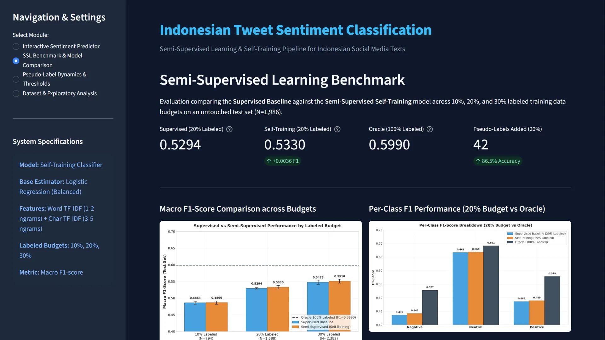
The benchmark comparison view summarizes key `20%` budget test metrics (`0.5294` Supervised vs. `0.5330` Self-Training vs. `0.5990` Oracle Macro F1) alongside `86.5%` pseudo-label accuracy. Side-by-side charts illustrate consistent SSL gains across moderate labeled budgets and across all three individual sentiment classes.

### 3. Pseudo-Label Dynamics & Confidence Threshold Dashboard
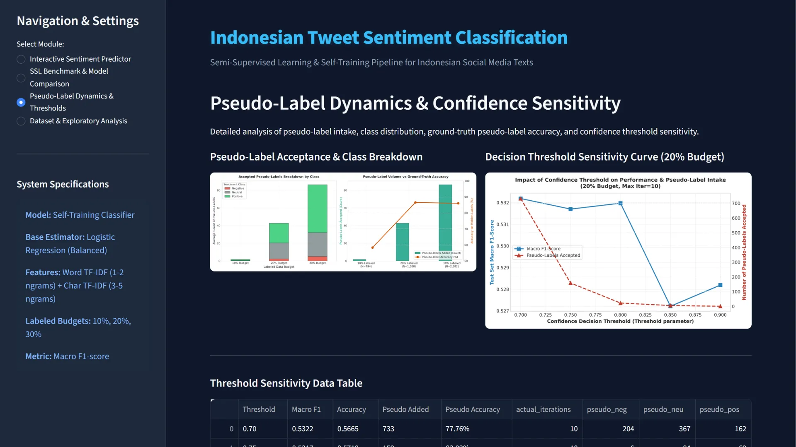
This analytical module pairs stacked pseudo-label class compositions and volume-versus-accuracy curves with the confidence threshold sensitivity sweep (`0.70`–`0.90`). Lowering the threshold increases pseudo-label intake sharply (`733` samples at `0.70`) at the cost of lower pseudo-label precision (`77.76%`), whereas `0.80` achieves `95.65%` accuracy on `seed=42`.

### 4. Dataset Quality Audit & Exploratory Analysis Dashboard
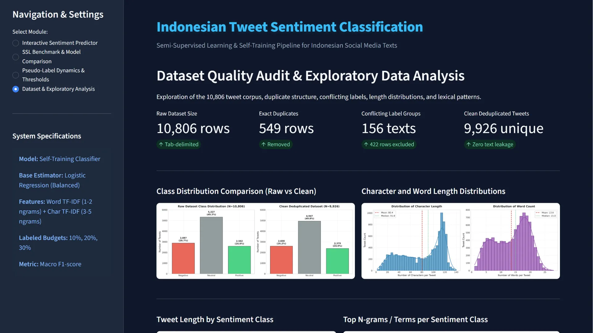
The exploratory audit module reports dataset integrity metrics (`10,806` raw rows, `549` exact duplicates, `156` conflicting text groups spanning `422` rows, and `9,926` clean unique tweets). Embedded visualizations verify that conflict exclusion preserves class proportions while revealing length ceilings at `140` characters.

### 5. Confidence Threshold Sensitivity & Pseudo-Label Intake Dynamics
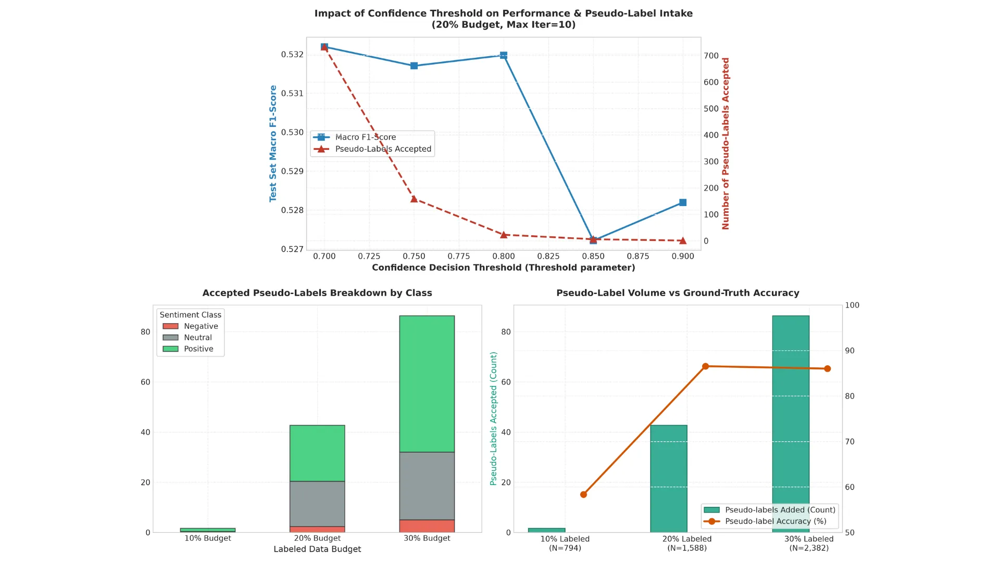
This composite plot contrasts the `20%` budget (`max_iter=10`) threshold trade-off curve (`0.70`–`0.90`) with multi-budget pseudo-label class distributions and ground-truth accuracy. While `10%` budgets suffer threshold starvation, `20%` and `30%` budgets ingest `43` and `86` mean pseudo-labels at over `86%` accuracy.

### 6. Tweet Length Distributions & Top Sentiment N-Grams
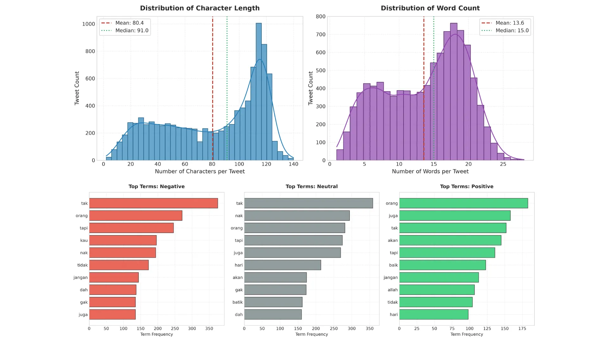
Histograms across the clean corpus highlight a left-skewed character length distribution (`Mean: 80.4`, `Median: 91.0`) peaking near `115`–`120` characters and a word count distribution centered at `Mean: 13.6` (`Median: 15.0`). Horizontal bar charts confirm high lexical overlap across classes alongside preserved negation terms such as *tak*, *tidak*, and *jangan*.

### 7. Class Distribution Comparison & Length-by-Sentiment Boxplots
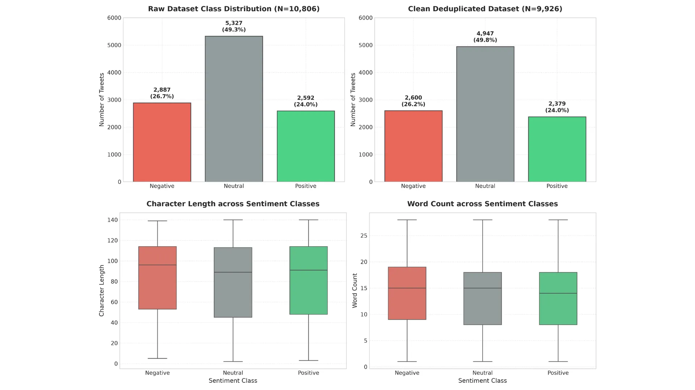
Bar comparisons confirm that cleaning from `10,806` raw rows to `9,926` unique deduplicated records maintains stable class shares (`26.2%` Negative, `49.8%` Neutral, `24.0%` Positive). Boxplots demonstrate closely aligned interquartile character and word lengths across all three polarities.

### 8. Macro F1 Across Budgets & Per-Class F1 Comparison
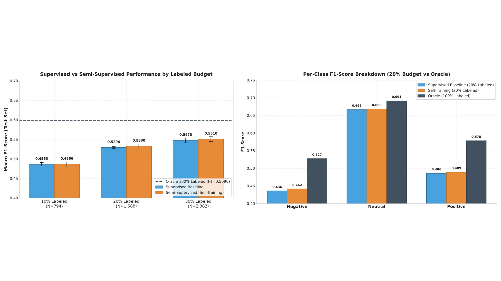
Holdout test Macro F1 progresses steadily from `10%` (`0.4863` / `0.4866`) to `20%` (`0.5294` / `0.5330`) and `30%` (`0.5478` / `0.5510`), narrowing the gap toward the `100%` Oracle (`0.5990`). Per-class bars at the `20%` budget show Self-Training lifting F1 across Negative, Neutral, and Positive classes simultaneously.

### 9. Normalized Confusion Matrices (20% Budget, Seed 42)
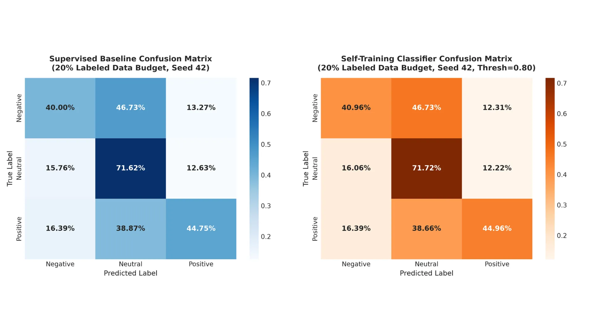
Normalized confusion matrices compare the Supervised Baseline (`40.00%` Negative, `71.62%` Neutral, `44.75%` Positive recall) against Self-Training at `threshold=0.80` (`40.96%` Negative, `71.72%` Neutral, `44.96%` Positive recall). Both matrices reveal that `46.73%` of Negative tweets and `38.66%`–`38.87%` of Positive tweets are absorbed into the majority Neutral prediction column.

## Prerequisites

- **Operating System:** Windows, macOS, or Linux (verified on Windows 11)
- **Python Runtime:** Python 3.10+ (project dependencies pinned and verified on Python `3.15.1` in [requirements.txt](requirements.txt))
- **Core Libraries:** `scikit-learn==1.9.1`, `pandas==3.1.1`, `numpy==2.5.4`, `matplotlib==3.11.2`, `seaborn==0.13.2`, `streamlit==1.67.0`, `joblib==1.6.0`, `tabulate>=0.9.0`
- **Compute:** Standard multi-core CPU and ~1 GB RAM (no GPU or CUDA required)
- **Dataset:** Local raw TSV corpus at [dataset/original/Indonesian_Sentiment_Twitter_Dataset_Labeled.csv](dataset/original/Indonesian_Sentiment_Twitter_Dataset_Labeled.csv)

## Installation & Setup

1. Clone the repository and enter the project directory:
   ```bash
   git clone https://github.com/weztcy/Indonesian-Tweet-Sentiment-Classification.git
   cd "Indonesian Tweet Sentiment Classification"
   ```
2. Create and activate a virtual environment:
   ```bash
   python -m venv .venv
   # Windows PowerShell:
   .venv\Scripts\Activate.ps1
   # macOS/Linux:
   source .venv/bin/activate
   ```
3. Install the exact pinned dependencies from [requirements.txt](requirements.txt):
   ```bash
   pip install -r requirements.txt
   ```

## Usage & Execution

You can run the data preparation self-test, execute CLI predictions with the pre-generated [models/best_model.joblib](models/best_model.joblib) artifact, or launch the interactive Streamlit dashboard.

1. Run single-tweet sentiment inference via the CLI ([src/predict.py](src/predict.py)):
   ```bash
   python src/predict.py --model models/best_model.joblib --tweet "Pelayanan sangat memuaskan dan cepat!"
   ```
2. Run interactive CLI mode (prompts continuously until `exit`):
   ```bash
   python src/predict.py --model models/best_model.joblib
   ```
3. Run batch CSV predictions (creates `outputs/predictions/batch_predictions.csv`; ensure `outputs/predictions/` exists first):
   ```bash
   python src/predict.py --model models/best_model.joblib --file dataset/test_set.csv
   ```
4. Launch the dark-mode Streamlit dashboard ([streamlit/app.py](streamlit/app.py)):
   ```bash
   streamlit run streamlit/app.py
   ```
   > Note: [streamlit/app.py](streamlit/app.py) reads artifacts from `outputs/` (`outputs/models/best_model.joblib`, `outputs/tables/*.csv`, `outputs/figures/*.png`, `outputs/predictions/test_set.csv`). Run `python src/train.py` and `python src/evaluate.py` first—after verifying the raw dataset path—so the `outputs/` tree is populated.

## Reproducibility & Execution

The full experimental benchmark, statistical tables, and 300 DPI figures are deterministically scripted using fixed seeds (`42` for the `80/20` train/test split; `42`, `123`, `456` for budget subsampling and model initialization). Because [src/data_preparation.py](src/data_preparation.py) defaults to `dataset/Indonesian_Sentiment_Twitter_Dataset_Labeled.csv` while the committed file resides in `dataset/original/`, pass or mirror the raw dataset path before regenerating `outputs/`.

1. Verify the raw dataset path (`dataset/original/Indonesian_Sentiment_Twitter_Dataset_Labeled.csv`) or copy/symlink it to `dataset/Indonesian_Sentiment_Twitter_Dataset_Labeled.csv` if running default CLI entry points without edits.
2. Run the data audit and leakage verification check:
   ```bash
   python src/data_preparation.py
   ```
3. Execute the full multi-budget, multi-seed benchmark, Oracle run, threshold sensitivity sweep, and majority-vote conflict experiment (writes to `outputs/`):
   ```bash
   python src/train.py
   ```
4. Generate all 10 diagnostic figures (`300` DPI) and formatted Markdown tables:
   ```bash
   python src/evaluate.py
   ```
5. Limitations on exact binary reproduction: exact floating-point timings (`train_time_sec`) vary by CPU load, and matching `tables/` scores requires the pinned library versions in [requirements.txt](requirements.txt).

## Contributing

Contributions to improve feature engineering, semi-supervised thresholding strategies, or corpus coverage are welcome. Please follow these steps when submitting changes:

1. Fork the repository.
2. Create a feature branch for your change (`git checkout -b feature/your-feature`).
3. Make the changes cleanly within `src/` or `streamlit/` while preserving leakage-free splitting guarantees.
4. Run relevant checks (`python src/data_preparation.py` and benchmark scripts) when available.
5. Commit and push the branch to your fork.
6. Open a pull request with a clear explanation of the changes and observed results.

## License

This project is licensed under the MIT License.
See the [LICENSE](LICENSE) file for details.

## Author & Contact

**Yohanes Dimas Pratama**

- GitHub: [github.com/weztcy](https://github.com/weztcy)
- Portfolio: [yohanesdimas.com](https://yohanesdimas.com)
- LinkedIn: [linkedin.com/in/yohanes-dimas](https://www.linkedin.com/in/yohanes-dimas)
