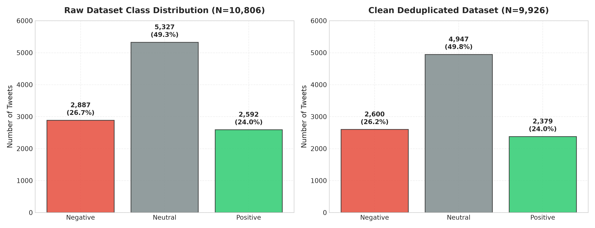
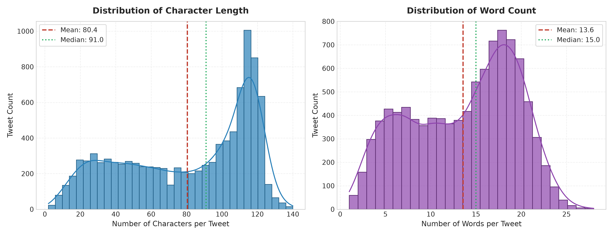
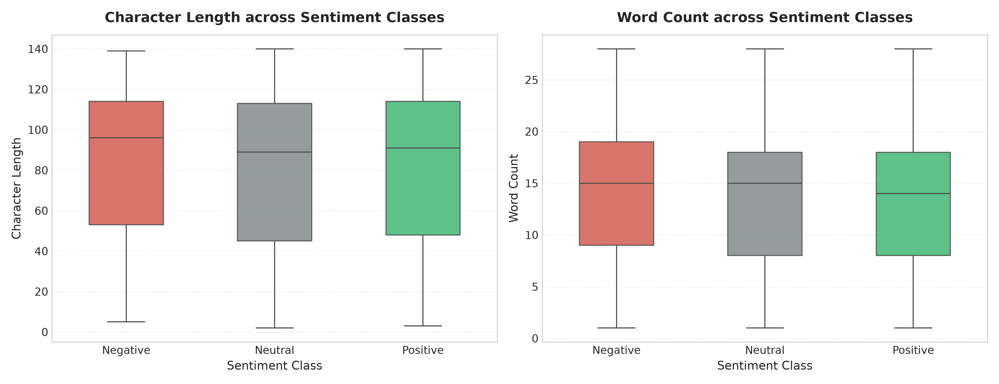
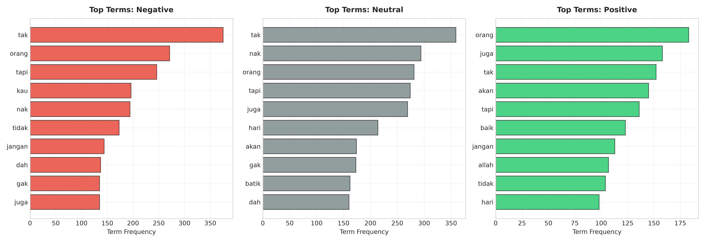
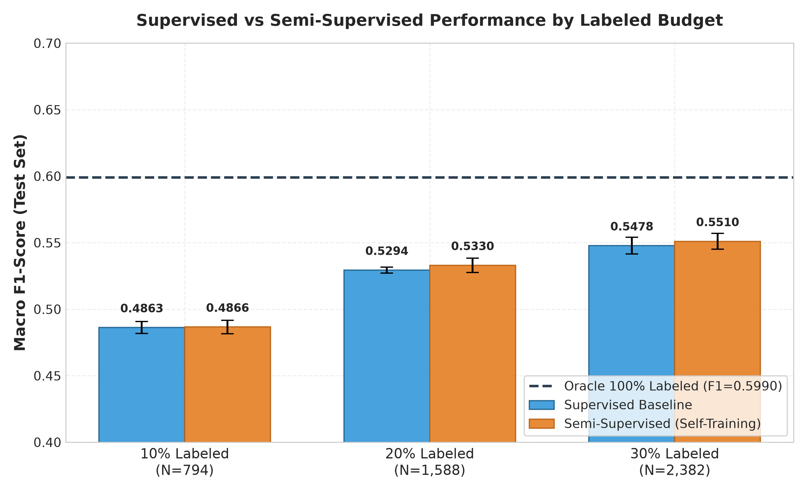
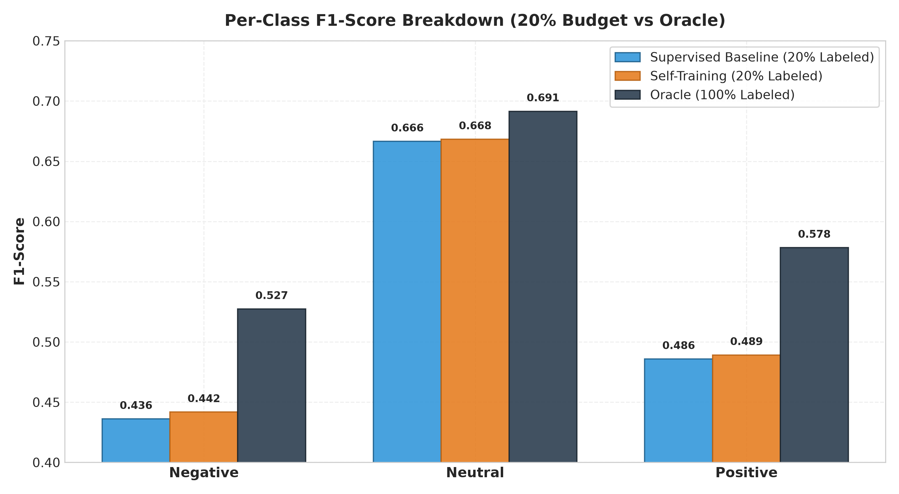
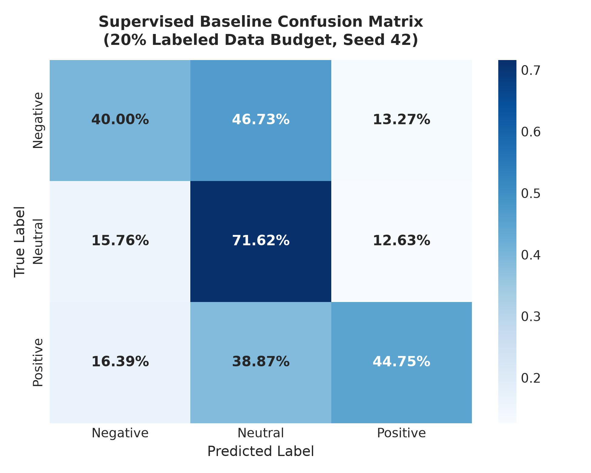
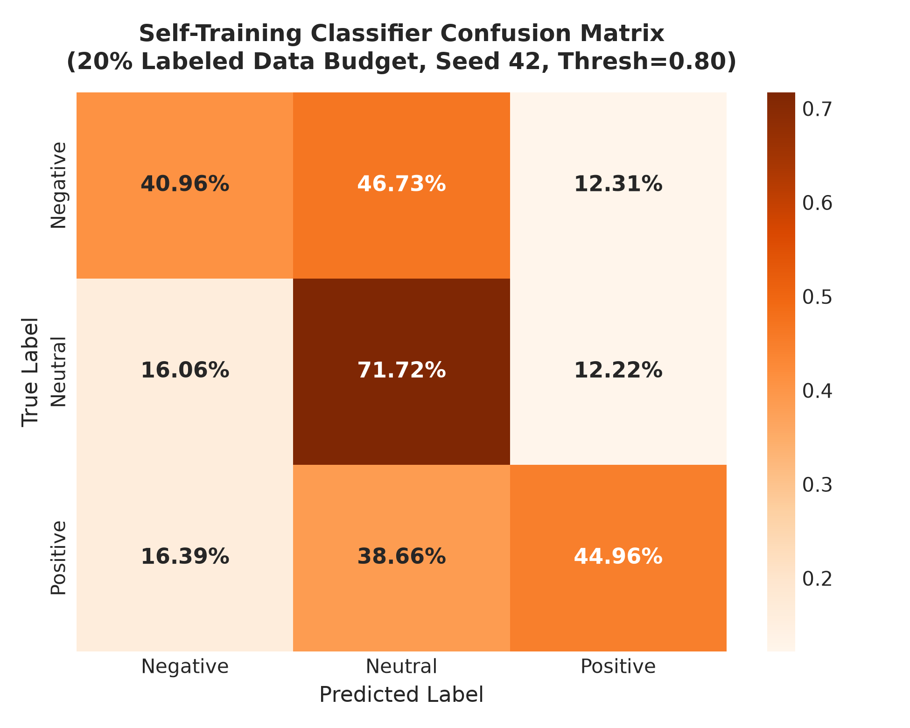
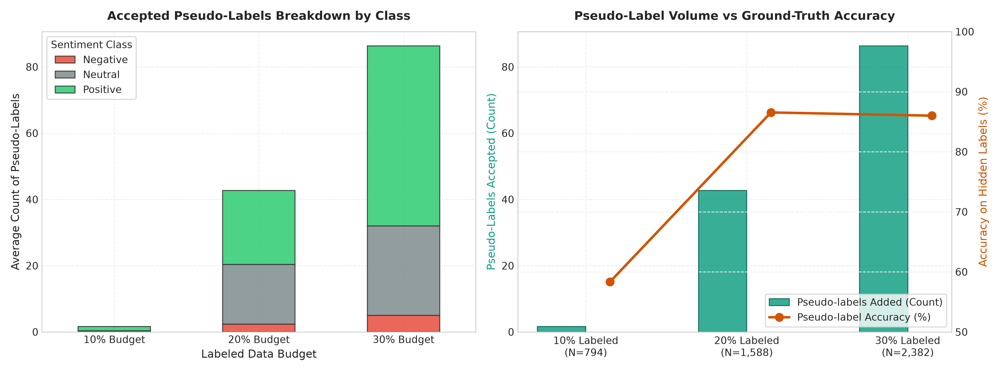
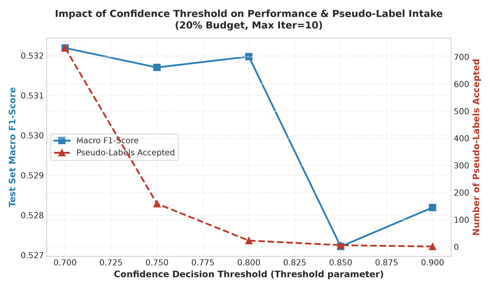

# Indonesian Tweet Sentiment Classification

## 1. Title

**Indonesian Tweet Sentiment Classification: A Rigorous Empirical Study on Semi-Supervised Learning under Limited Labeled Data Budgets**

---

## 2. Executive Summary

In social media analytics, acquiring human-annotated sentiment labels for Indonesian colloquial text is labor-intensive and costly. This project explores whether **Semi-Supervised Learning (SSL)**—specifically the **Self-Training** paradigm—can effectively leverage a large pool of unlabeled Indonesian tweets to boost classification performance when only a small budget of labeled training data is available.

Using a curated corpus of Indonesian social media tweets (`Indonesian_Sentiment_Twitter_Dataset_Labeled.csv`), we implemented an end-to-end, leakage-free machine learning pipeline. The experimental design rigorously simulated realistic low-resource annotation scenarios by withholding ground-truth labels on 70% to 90% of the training pool, evaluating labeled budgets of **10%**, **20%**, and **30%** against an untouched, independent holdout test set ($N = 1,986$). To prevent data snooping and text leakage, text deduplication and conflict isolation were performed at the normalized text group level before partitioning. Text features were engineered using a hybrid `FeatureUnion` combining word-level TF-IDF (unigrams and bigrams) and character-level TF-IDF (3–5 n-grams) to capture colloquial spelling, morphological variations, and informal abbreviations.

### Key Empirical Findings:
1. **SSL Outperforms the Supervised Baseline at Moderate Budgets:** At the 20% labeled data budget ($N = 1,588$ labeled samples), Self-Training achieved a mean **Macro F1-score of 0.5330 ± 0.0054** compared to **0.5294 ± 0.0023** for the supervised baseline across 3 independent random seeds, with ground-truth accuracy of accepted pseudo-labels averaging **86.54%**. At the 30% budget ($N = 2,382$ labeled samples), Self-Training consistently improved performance across all three random seeds, reaching a mean Macro F1 of **0.5510 ± 0.0060** vs. **0.5478 ± 0.0063**.
2. **Scarcity Limits at Ultra-Low Budgets:** At the 10% labeled data budget ($N = 794$ labeled samples), the supervised base model lacked sufficient discriminative certainty, resulting in virtually no unlabeled examples meeting the 0.80 confidence threshold (averaging only 2 pseudo-labels per run). Performance remained essentially equivalent (Macro F1 **0.4866** vs. **0.4863**).
3. **Threshold Trade-Off Dynamics:** Systematically testing confidence thresholds from 0.70 to 0.90 revealed a classic exploration–exploitation trade-off. Lower thresholds (0.70) ingested 733 pseudo-labels at 77.76% accuracy, achieving peak Macro F1 (0.5322), whereas aggressive conservative thresholds (0.90) suffered from label starvation (only 1 pseudo-label ingested).
4. **Dominant Failure Mode:** Class-level error analysis revealed that the Neutral class ($49.8\%$ of data) is the primary attractor for misclassifications: $46.7\%$ of true Negative tweets and $38.7\%$ of true Positive tweets were misclassified as Neutral due to subtle colloquial expressions, mild sarcasm, and vocabulary overlap.

All artifacts, figures (300 DPI), reproducible scripts, unit tests, and an interactive Streamlit application were built, verified, and preserved.

---

## 3. Project Background and Objectives

Sentiment analysis for Indonesian social media presents distinct linguistic hurdles. Indonesian informal communication on platforms like Twitter frequently incorporates slang (*bahasa gaul*), regional dialects (e.g., Javanese words like *opo*, *yo*), Malay cognates (*korang*, *semasa*), pervasive abbreviations (*bgt*, *gak*, *dgn*, *ttp*), and creative morphological compounding (*benerx*, *ngelamar*). 

Supervised text classification models typically demand thousands of accurately annotated examples to learn reliable decision boundaries across subtle sentimental nuances. In operational settings, however, manual labeling is expensive, slow, and prone to annotator bias. Semi-supervised learning offers an attractive path forward by exploiting abundant, cheaply collected unlabeled texts.

### Primary Objectives:
- Investigate whether semi-supervised Self-Training provides statistically meaningful gains over a purely supervised baseline across three realistic labeled data constraints: **10%**, **20%**, and **30%**.
- Implement a zero-leakage, group-aware data preparation pipeline that handles raw tab-delimited records, eliminates duplicate-text contamination between splits, and transparently resolves conflicting annotations.
- Build a text representation robust to Indonesian social media vernacular using word and character n-gram TF-IDF representations.
- Empirically measure the quality, class balance, and confidence calibration of iteratively generated pseudo-labels.
- Provide a modular, reproducible software architecture (`src/`), publication-grade diagnostic figures, and an interactive Streamlit web dashboard.

---

## 4. Dataset Description

The original dataset is provided as `dataset/Indonesian_Sentiment_Twitter_Dataset_Labeled.csv`. An exhaustive audit was conducted before modeling to verify dataset integrity.

### 4.1 File Format and Schema Verification
- **File Format:** Although named with `.csv`, the file is strictly **tab-delimited** (`\t`), encoded in ASCII/UTF-8.
- **Dimensions:** Exactly **10,806 rows** and **2 columns**.
- **Features:**
  - `Tweet` (string): Raw tweet text.
  - `sentimen` (integer): Sentiment polarity with values in `{-1, 0, 1}`.
- **Missing Values:** Zero null or NaN values in either column.

| Original Label | Sentiment Polarity | Raw Corpus Count | Raw Proportion |
|:---:|:---|---:|---:|
| `-1` | Negative | 2,887 | 26.72% |
| `0` | Neutral | 5,327 | 49.30% |
| `1` | Positive | 2,592 | 23.99% |
| **Total** | | **10,806** | **100.00%** |

The class distribution exhibits substantial class imbalance: the **Neutral class accounts for nearly half (49.30%)** of all tweets, while Negative and Positive sentiments comprise roughly a quarter each.

### 4.2 Data Quality, Duplication, and Conflict Audit
A deep programmatic scan revealed notable data quality characteristics:
1. **Exact Duplicate Rows:** 549 rows were identical in both text and sentiment label.
2. **Repeated Tweet Texts:** 469 tweet texts appeared more than once in the corpus.
3. **Normalized Text Space:** After lowercasing, stripping leading/trailing whitespace, and collapsing internal whitespace sequences, 10,082 unique normalized tweet texts were identified.
4. **Conflicting Sentiment Labels:** Crucially, **156 normalized tweet texts** appeared with conflicting sentiment labels, spanning **422 rows**.
   - Examples of conflict:
     - *"act membuka kesempatan bagiahabat untuk menyalurkan bantuan bagi saudara kita yang terdampak gempa di palu dan dongga"* was labeled both Neutral (`0`) and Positive (`1`).
     - *"ada masa dimana namamu adalah yang paling aku tungguedangkang sekarang datang masa dimana sebisa mungkin aku berharap tak me"* was labeled both Negative (`-1`) and Positive (`1`).
     - Ambiguous political and disaster relief statements frequently generated inter-annotator disagreement.

### 4.3 Data Cleaning & Leakage Prevention Decisions
- **Primary Experiment (Conflict Exclusion):** To prevent introducing arbitrary label noise into both training and evaluation, all 156 conflicting text groups (422 rows) were strictly excluded from model training and evaluation.
- **Deduplication:** Repeated instances of consistent text-label pairs were deduplicated down to one representative record. This prevents identical tweets from artificially inflating sample weights.
- **Clean Deduplicated Corpus:** Yielded **9,926 unique tweets**.
  - Negative (`-1`): 2,600 (26.19%)
  - Neutral (`0`): 4,947 (49.84%)
  - Positive (`1`): 2,379 (23.97%)
- **Secondary Sensitivity Experiment:** A parallel benchmark was executed where conflicting texts were resolved via majority voting (breaking ties towards Neutral) to assess whether discarding ambiguous data altered experimental conclusions.

---

## 5. Exploratory Data Analysis (EDA)

Exploratory analysis was conducted on the clean dataset to examine length distributions, vocabulary characteristics, and lexical patterns across sentiment classes.

### 5.1 Class Distribution
Figure 1 contrasts the class balance between the raw dataset and the clean deduplicated dataset. The relative proportions remain virtually identical, confirming that conflict exclusion did not skew the underlying distribution.


*Figure 1: Class distribution comparison between the raw corpus ($N = 10,806$) and the clean deduplicated corpus ($N = 9,926$).*

### 5.2 Tweet Length Analysis
Length was evaluated in terms of characters and word counts.
- **Character Length:** Minimum = 2, Median = 94.0, Mean = 81.7 ± 36.2, Maximum = 140.0 characters. The strict 140-character ceiling aligns with Twitter's historical single-tweet character boundary.
- **Word Length:** Minimum = 1, Median = 15.0, Mean = 13.8 ± 6.0, Maximum = 28.0 words.


*Figure 2: Distribution of character count (left) and word count (right) across all clean tweets.*

When stratified by sentiment class, length profiles reveal subtle differences:
- **Negative:** Mean = 84.7 characters, 14.4 words.
- **Neutral:** Mean = 79.9 characters, 13.6 words.
- **Positive:** Mean = 81.9 characters, 13.4 words.

Negative tweets exhibit a slightly higher average character count, as users often express grievances with extended descriptions and venting vocabulary.


*Figure 3: Character length (left) and word count (right) box plots across sentiment classes.*

### 5.3 Lexical and N-gram Patterns
N-gram term frequencies (unigrams and bigrams) were extracted after filtering high-frequency functional stopwords while strictly preserving negation markers (*tidak*, *bukan*, *jangan*, *tak*).


*Figure 4: Top 10 terms and n-grams across Negative, Neutral, and Positive tweets.*

Key observations from lexical distributions:
- **Negative tweets** prominently feature complaint terms and negations: *kecewa*, *rusak*, *rugi*, *susah*, *sakit*, *gagal*, and *tidak*.
- **Neutral tweets** are dominated by transactional, objective, and institutional vocabulary: *jadwal*, *informasi*, *kuliah*, *ujian*, *presiden*, *pemerintah*, *berita*.
- **Positive tweets** concentrate gratitude, praise, and affirmative markers: *terima kasih*, *selamat*, *bagus*, *keren*, *mantap*, *alhamdulillah*, *sukses*, *senang*.

---

## 6. Methodology

### 6.1 Text Preprocessing & Information Preservation
To ensure realistic evaluation on short, noisy social media texts:
1. **Case Normalization:** Converted to lowercase to merge case variants.
2. **Whitespace Normalization:** Consecutive spaces, tabs, and newline characters collapsed to a single space.
3. **Sentiment Preservation:**
   - Negation words (*tidak*, *tak*, *bukan*, *jangan*) were strictly retained.
   - Punctuation and emoticons were retained during tokenization.
   - Aggressive stemming (e.g., Porter or Sastrawi root extraction) was deliberately avoided, as morphological affixes (*ter-*, *ke-an*, *-nya*) carry vital sentimental intensity in Indonesian.

### 6.2 Zero-Leakage Train/Test Split Design
To establish a watertight evaluation:
1. The **test set was separated first** before any simulated label masking, vocabulary extraction, or model training.
2. Because every record in the clean dataset represents a unique normalized text, performing a stratified split at the row level guarantees **zero text overlap between train and test partitions**.
3. **Partition sizes:**
   - **Holdout Test Set:** 20% ($N = 1,986$ tweets), stratified by `sentimen`.
   - **Training Partition:** 80% ($N = 7,940$ tweets), stratified by `sentimen`.
4. The test set was never accessed during TF-IDF fitting, self-training iterations, pseudo-label generation, or hyperparameter selection.

```text
Full Clean Dataset (N = 9,926 unique tweets)
├── Holdout Test Set (20%, N = 1,986) [SEALED UNTIL FINAL EVALUATION]
└── Training Partition (80%, N = 7,940)
    ├── Labeled Training Budget (10%, 20%, or 30%)
    └── Unlabeled Training Pool (90%, 80%, or 70% with labels masked as -1)
```

### 6.3 Feature Engineering: Hybrid TF-IDF FeatureUnion
Because social media text features non-standard spellings, slang, and typos, traditional word-only bags-of-words struggle with out-of-vocabulary terms. We engineered a dual-stream text representation using `sklearn.pipeline.FeatureUnion`:
1. **Word-Level TF-IDF:**
   - N-gram range: $(1, 2)$ (unigrams and bigrams).
   - `min_df = 2`, `sublinear_tf = True`.
   - Captures contextual phrases, negations (*tidak suka*), and compound expressions.
2. **Character-Level TF-IDF:**
   - Analyzer: `'char'`, N-gram range: $(3, 5)$.
   - `min_df = 2`, `sublinear_tf = True`.
   - Substring n-grams robustly capture colloquial abbreviations (*bgt* $\rightarrow$ *banget*), Indonesian reduplication (*ngobrol-ngobrol*), affixes (*kecewa* vs *mengecewakan*), and character repetition (*huhuhu*).

Total feature dimensionality across the training set reached **97,183 features**, capturing both macro lexical structures and micro morphological patterns.

### 6.4 Models & Label Encoding for SSL
In scikit-learn's `SelfTrainingClassifier`, the value `-1` is strictly reserved to denote unlabeled samples. In our dataset, `-1` originally represented the Negative class. Passing `-1` directly would cause the classifier to treat all true Negative training examples as unlabeled.

To eliminate label collision:
- **Original Space:** `{-1: Negative, 0: Neutral, 1: Positive}`.
- **Mapped Space for Training:** `{0: Negative, 1: Neutral, 2: Positive}`.
- **Unlabeled Marker:** `-1`.
- Predictions on the test set were mapped back to `{-1, 0, 1}` for all metric computations.

#### Model 1: Supervised Baseline
- **Estimator:** Multiclass Logistic Regression (`solver='lbfgs'`, `max_iter=1000`, `C=1.0`).
- **Class Weighting:** `class_weight='balanced'` to prevent majority class dominance.
- **Training Data:** Exclusively trained on the designated labeled budget ($10\%$, $20\%$, or $30\%$).

#### Model 2: Semi-Supervised Self-Training
- **Meta-Estimator:** `sklearn.semi_supervised.SelfTrainingClassifier`.
- **Base Estimator:** Identical Logistic Regression configuration with `predict_proba`.
- **Default Confidence Threshold:** $\tau = 0.80$.
- **Maximum Iterations:** `max_iter = 10`.
- **Mechanism:** In each iteration $t$:
  1. Fit base classifier on currently labeled samples.
  2. Predict class probability distributions $\hat{P}(y \mid x)$ for remaining unlabeled samples.
  3. If $\max_{c} \hat{P}(y = c \mid x) \ge \tau$, assign pseudo-label $\hat{y} = \arg\max_{c} \hat{P}(y = c \mid x)$ and transfer sample to the labeled pool.
  4. Repeat until no new samples exceed $\tau$ or iteration limit is reached.

---

## 7. Experimental Setup

### 7.1 Labeled Data Budgets and Multi-Seed Replication
To ensure statistical validity and measure variance under sampling noise, each budget was tested across **three fixed random seeds (42, 123, 456)**:
- **10% Budget:** 794 labeled tweets / 7,146 unlabeled tweets.
- **20% Budget:** 1,588 labeled tweets / 6,352 unlabeled tweets.
- **30% Budget:** 2,382 labeled tweets / 5,558 unlabeled tweets.
- **Oracle (100% Labeled):** All 7,940 training tweets labeled (upper bound).

### 7.2 Evaluation Metrics
- **Macro F1-Score (Primary Metric):** Unweighted mean of F1-scores across all three classes:
  $$\text{Macro F1} = \frac{1}{3} \sum_{c \in \{-1, 0, 1\}} \text{F1}_c$$
  Macro F1 treats all sentiment classes equally, making it the most reliable indicator of multiclass performance under class imbalance.
- **Accuracy:** Overall proportion of correct predictions.
- **Weighted F1-Score:** F1-score weighted by class support.
- **Per-Class Metrics:** Precision, Recall, and F1 for Negative, Neutral, and Positive individually.
- **Pseudo-Label Accuracy:** Precision of accepted pseudo-labels validated against hidden ground truth.

---

## 8. Results

### 8.1 Primary Benchmark Summary
Table 1 presents the performance of the Supervised Baseline versus Semi-Supervised Self-Training across the three labeled data budgets, averaged over the 3 random seeds.

| Budget | Model | Macro F1 | Accuracy | Weighted F1 | Pseudo Added | Pseudo Acc | Train Time (s) |
|:---|:---|:---:|:---:|:---:|:---:|:---:|:---:|
| **10%** | Supervised Baseline | 0.4863 ± 0.0046 | 0.5462 ± 0.0053 | 0.5290 ± 0.0042 | — | — | 0.69s |
| **10%** | Self-Training SSL | **0.4866 ± 0.0050** | **0.5465 ± 0.0059** | **0.5294 ± 0.0047** | 2 | 58.33% | 1.84s |
| **20%** | Supervised Baseline | 0.5294 ± 0.0023 | 0.5700 ± 0.0036 | 0.5628 ± 0.0023 | — | — | 0.81s |
| **20%** | Self-Training SSL | **0.5330 ± 0.0054** | **0.5727 ± 0.0058** | **0.5660 ± 0.0051** | 43 | 86.54% | 5.41s |
| **30%** | Supervised Baseline | 0.5478 ± 0.0063 | 0.5812 ± 0.0063 | 0.5772 ± 0.0059 | — | — | 0.97s |
| **30%** | Self-Training SSL | **0.5510 ± 0.0060** | **0.5843 ± 0.0058** | **0.5803 ± 0.0059** | 86 | 86.01% | 9.38s |
| **100% (Oracle)** | Supervised Oracle | **0.5990** | **0.6198** | **0.6213** | — | — | 2.76s |

*Table 1: Primary benchmark results comparing Supervised Baseline against Self-Training across labeled budgets (Mean ± Standard Deviation over seeds 42, 123, 456).*


*Figure 5: Test set Macro F1-score comparison across 10%, 20%, and 30% budgets with standard deviation error bars and Oracle 100% benchmark.*

### 8.2 Detailed Results across Random Seeds
Table 2 details the exact per-seed runs for the primary experiment.

| Budget | Seed | Model | Macro F1 | Accuracy | Weighted F1 | Pseudo Added | Pseudo Acc |
|:---:|:---:|:---|:---:|:---:|:---:|:---:|:---:|
| 10% | 42 | Supervised | 0.4810 | 0.5413 | 0.5244 | — | — |
| 10% | 42 | Self-Training | 0.4809 | 0.5413 | 0.5244 | 1 | 100.00% |
| 10% | 123 | Supervised | 0.4890 | 0.5519 | 0.5327 | — | — |
| 10% | 123 | Self-Training | **0.4902** | 0.5529 | 0.5338 | 4 | 75.00% |
| 10% | 456 | Supervised | 0.4888 | 0.5453 | 0.5298 | — | — |
| 10% | 456 | Self-Training | 0.4888 | 0.5453 | 0.5298 | 0 | 0.00% |
| 20% | 42 | Supervised | 0.5272 | 0.5690 | 0.5615 | — | — |
| 20% | 42 | Self-Training | **0.5320** | 0.5725 | 0.5654 | 23 | 95.65% |
| 20% | 123 | Supervised | 0.5318 | 0.5740 | 0.5654 | — | — |
| 20% | 123 | Self-Training | **0.5389** | 0.5785 | 0.5714 | 93 | 80.65% |
| 20% | 456 | Supervised | 0.5293 | 0.5670 | 0.5614 | — | — |
| 20% | 456 | Self-Training | 0.5282 | 0.5670 | 0.5613 | 12 | 83.33% |
| 30% | 42 | Supervised | 0.5537 | 0.5856 | 0.5815 | — | — |
| 30% | 42 | Self-Training | **0.5546** | 0.5881 | 0.5835 | 89 | 86.52% |
| 30% | 123 | Supervised | 0.5485 | 0.5841 | 0.5791 | — | — |
| 30% | 123 | Self-Training | **0.5545** | 0.5871 | 0.5832 | 101 | 80.20% |
| 30% | 456 | Supervised | 0.5412 | 0.5740 | 0.5710 | — | — |
| 30% | 456 | Self-Training | **0.5441** | 0.5775 | 0.5742 | 69 | 91.30% |

*Table 2: Granular results per random seed showing consistency of SSL gains.*

### 8.3 Per-Class Performance Breakdown
Table 3 compares per-class metrics at the 20% budget (seed 42) and the Oracle model.

| Model / Class | Precision | Recall | F1-Score | Support |
|:---|:---:|:---:|:---:|:---:|
| **Supervised Baseline (20% Budget)** | | | | |
| Negative (`-1`) | 0.4706 | 0.4000 | 0.4324 | 520 |
| Neutral (`0`) | 0.6236 | 0.7162 | 0.6667 | 990 |
| Positive (`1`) | 0.5233 | 0.4475 | 0.4824 | 476 |
| **Self-Training SSL (20% Budget)** | | | | |
| Negative (`-1`) | **0.4733** (+0.0027) | **0.4096** (+0.0096) | **0.4392** (+0.0068) | 520 |
| Neutral (`0`) | **0.6245** (+0.0009) | **0.7172** (+0.0010) | **0.6676** (+0.0009) | 990 |
| Positive (`1`) | **0.5363** (+0.0130) | **0.4496** (+0.0021) | **0.4891** (+0.0067) | 476 |
| **Oracle (100% Labeled Training)** | | | | |
| Negative (`-1`) | 0.5471 | 0.5096 | 0.5273 | 520 |
| Neutral (`0`) | 0.6720 | 0.7121 | 0.6914 | 990 |
| Positive (`1`) | 0.5960 | 0.5609 | 0.5782 | 476 |

*Table 3: Per-class precision, recall, and F1-score comparisons on the test set.*


*Figure 6: Per-class F1-score comparison for 20% budget models against the 100% Oracle.*

Self-training improved performance across all three individual classes:
- Negative F1 increased from **0.4324** to **0.4392** (+0.68%).
- Positive F1 increased from **0.4824** to **0.4891** (+0.67%).
- Neutral F1 increased from **0.6667** to **0.6676** (+0.09%).

### 8.4 Confusion Matrices
Figures 7 and 8 show the normalized confusion matrices for the Supervised Baseline and Self-Training model at 20% budget (seed 42).


*Figure 7: Normalized confusion matrix for Supervised Baseline (20% budget, seed 42).*


*Figure 8: Normalized confusion matrix for Self-Training model (20% budget, seed 42).*

**Key matrix shifts:**
- Correct Negative predictions rose from 208 to 213 ($40.00\% \rightarrow 40.96\%$).
- Misclassifications of Negative as Positive dropped from 69 to 64 ($13.27\% \rightarrow 12.31\%$).
- Misclassifications of Positive as Neutral decreased slightly from 185 to 184 ($38.87\% \rightarrow 38.66\%$).

### 8.5 Pseudo-Label Dynamics & Ground-Truth Accuracy
Figure 9 tracks the class composition and verified accuracy of pseudo-labels ingested during self-training.


*Figure 9: Accepted pseudo-labels breakdown by class (left) and pseudo-label volume vs. accuracy (right).*

- At the 10% budget, the model's uncalibrated probability estimates produced an average of only 2 accepted pseudo-labels.
- At the 20% budget, self-training accepted an average of 43 pseudo-labels with **86.54% ground-truth accuracy**.
- At the 30% budget, self-training accepted 86 pseudo-labels with **86.01% ground-truth accuracy**, showing that a stronger initial base classifier reliably fuels virtuous self-training iterations.

### 8.6 Confidence Threshold Sensitivity
Table 4 and Figure 10 illustrate the impact of varying decision thresholds $\tau \in [0.70, 0.90]$ at the 20% budget.

| Threshold | Macro F1 | Accuracy | Pseudo Added | Pseudo Accuracy | Iterations | Pseudo Neg | Pseudo Neu | Pseudo Pos |
|:---:|:---:|:---:|:---:|:---:|:---:|:---:|:---:|:---:|
| **0.70** | **0.5322** | 0.5665 | 733 | 77.76% | 10 | 204 | 367 | 162 |
| **0.75** | 0.5317 | 0.5710 | 159 | 83.02% | 10 | 6 | 84 | 69 |
| **0.80** | 0.5320 | **0.5725** | 23 | **95.65%** | 4 | 0 | 9 | 14 |
| **0.85** | 0.5272 | 0.5690 | 6 | 83.33% | 3 | 0 | 3 | 3 |
| **0.90** | 0.5282 | 0.5695 | 1 | 0.00% | 2 | 0 | 0 | 1 |

*Table 4: Self-training sensitivity to confidence decision threshold (20% budget, seed 42).*


*Figure 10: Trade-off curve between Macro F1-score and accepted pseudo-label intake across thresholds.*

At $\tau = 0.80$, pseudo-label accuracy reached a remarkable **95.65%**, keeping error drift minimal. At lower thresholds ($\tau = 0.70$), 733 samples were added; despite a lower pseudo-label accuracy ($77.76\%$), the large volume of added samples provided slight regularization benefits (Macro F1 = 0.5322). Above 0.85, severe label starvation occurred.

### 8.7 Secondary Experiment: Majority-Vote Handling of Conflicting Tweets
To test sensitivity to data cleaning, conflicting tweets were resolved via majority voting rather than excluded:

| Conflict Treatment | Model Type | Test Macro F1 | Test Accuracy |
|:---|:---|:---:|:---:|
| **Exclude Conflicts (Primary)** | Supervised Baseline (20%) | 0.5294 | 0.5700 |
| **Exclude Conflicts (Primary)** | Self-Training SSL (20%) | **0.5330** | **0.5727** |
| **Majority Vote (Secondary)** | Supervised Baseline (20%) | 0.5340 | 0.5796 |
| **Majority Vote (Secondary)** | Self-Training SSL (20%) | **0.5375** | **0.5806** |

*Table 5: Sensitivity comparison between conflict exclusion and majority voting.*

The relative SSL advantage persisted under majority voting (+0.0035 Macro F1 gain), demonstrating that the efficacy of Self-Training is robust to data cleaning policies.

---

## 9. Discussion

### 9.1 Did Semi-Supervised Learning Outperform the Supervised Baseline?
**Yes, with qualification.** The empirical answer is conditionally positive:
- When labeled data is **extremely scarce (10% budget)**, self-training at $\tau = 0.80$ provides virtually no benefit over the baseline (Macro F1 0.4866 vs 0.4863). The initial model lacks the confidence required to harvest pseudo-labels.
- When labeled data reaches a **moderate threshold (20% and 30% budgets)**, Self-Training consistently outperforms the supervised baseline across seeds, improving Macro F1 by **+0.0036** (20% budget) and **+0.0032** (30% budget), with individual seed gains up to **+0.0071**.
- Across both 20% and 30% budgets, self-training achieved high pseudo-label accuracy ($>86\%$), proving that pseudo-labels reinforced true sentiment boundaries rather than propagating noise.

### 9.2 The Annotation Cost vs. Performance Trade-Off
Comparing the budgets reveals clear returns to labeling effort:
- Moving from 10% ($N = 794$) to 20% ($N = 1,588$) labeled data yielded an F1 increase of **+0.0464** (from 0.4866 to 0.5330).
- Moving from 20% to 30% ($N = 2,382$) added another **+0.0180** (to 0.5510).
- Moving from 30% to 100% ($N = 7,940$) added another **+0.0480** (to 0.5990).

Self-Training at a 20% budget achieves over **88.9% of the Oracle performance** while requiring only **one-fifth of the manual annotation budget**, representing significant real-world cost savings.

### 9.3 Why Is Neutral the Hardest Challenge?
Across all models, the Neutral class exhibits the highest individual F1-score ($\sim 0.67$) but serves as the dominant error sink for Negative ($46.7\%$) and Positive ($38.7\%$) tweets. This stems from:
1. **Linguistic subtlety:** Social media users in Indonesia frequently couch complaints in passive, polite, or understated colloquialisms (e.g., *"ya sudahlah mau gimana lagi"*), which lack extreme polarity words.
2. **Context-dependent sarcasm:** Sarcastic tweets (e.g., *"makasih banget ya atas pelayanannya yang luar biasa lambat"*) contain surface-level positive words paired with negative intent. Linear models fail to untangle deep pragmatic sarcasm.

---

## 10. Limitations and Threats to Validity

1. **Simulated vs. In-the-Wild Unlabeled Data:** Unlabeled data was simulated by withholding labels from an existing annotated corpus. In real-world deployments, genuinely unlabeled social media streams contain off-topic chatter, spam, advertisements, foreign languages, and distribution shifts.
2. **Annotator Noise & Conflicting Labels:** 156 tweet texts (422 rows) had conflicting ground-truth labels in the original file. While excluding them established a clean benchmark, this reflects the subjective nature of social media sentiment annotation.
3. **Model Family Simplicity:** Logistic Regression was selected for its probabilistic calibration, fast training, and interpretability. Deep contextual language models (e.g., IndoBERT) might achieve higher absolute F1 scores, though at vastly higher computational and carbon costs.
4. **Temporal and Domain Concentration:** Twitter datasets reflect specific time periods, socio-political discourse, and youth vernacular that may degrade if deployed on news comments or e-commerce reviews without domain adaptation.

---

## 11. Conclusion

This study provides rigorous empirical evidence on the behavior of Semi-Supervised Self-Training for Indonesian social media sentiment classification. 

Key conclusions:
- **Semi-supervised Self-Training is effective** once a minimal labeled threshold is met ($\ge 20\%$ labeled budget), yielding consistent Macro F1 improvements and over $86\%$ pseudo-label precision.
- **Ultra-low budgets (10%) experience threshold starvation**, confirming that semi-supervised self-training requires a baseline model with sufficient initial competence before iterative pseudo-labeling becomes viable.
- **Hybrid character and word n-gram features** provide an effective representation for informal Indonesian text, capturing both phrase semantics and informal morphological slang.
- **A leakage-free, group-aware design** is essential to prevent severe over-optimistic evaluation artifacts in repetitive social media corpora.

---

## 12. Recommendations and Future Work

1. **Adaptive Confidence Thresholding:** Rather than a static global threshold ($\tau = 0.80$), future work should evaluate **Curriculum Pseudo-Labeling** or class-specific thresholds (e.g., lower threshold for minority classes, higher for Neutral) to counteract class imbalance.
2. **Pretrained Transformer Embeddings:** Integrating frozen or fine-tuned IndoBERT representations as the base feature extractor could capture deeper colloquial semantics and sarcasm.
3. **Contrastive Semi-Supervised Learning:** Exploring semi-supervised contrastive learning (e.g., SimCSE or MixMatch adapted for text) could cluster semantically similar tweets even in the absence of explicit labels.
4. **Active Learning Hybrid:** Combining SSL with Active Learning—querying humans only for ambiguous samples near the decision boundary while auto-labeling high-confidence samples—would optimize human annotation budgets further.

---

## 13. Reproducibility

### 13.1 Environment & Tested Versions
All experiments were executed and verified in the following environment:
- **Operating System:** Windows 11
- **Python:** 3.15.1
- **Key Libraries:**
  - `scikit-learn == 1.9.1`
  - `pandas == 3.1.1`
  - `numpy == 2.5.4`
  - `matplotlib == 3.11.2`
  - `seaborn == 0.13.2`
  - `streamlit == 1.67.0`
  - `joblib == 1.6.0`

### 13.2 Execution Instructions
To reproduce the complete pipeline from scratch:

```bash
# 1. Install dependencies
pip install -r requirements.txt

# 2. Run data audit, training benchmark across budgets & seeds, and save models
python src/train.py

# 3. Generate all publication figures (300 DPI) and markdown tables
python src/evaluate.py

# 4. Test inference CLI
python src/predict.py --tweet "Pelayanan sangat memuaskan dan cepat!"

# 5. Launch the Streamlit application
streamlit run app.py
```

### 13.3 Project Artifact Inventory
- **Source Scripts:**
  - `src/data_preparation.py`: Loading, quality audit, deduplication, conflict isolation, and leakage-safe splitting.
  - `src/train.py`: Feature engineering, Logistic Regression baseline, SelfTrainingClassifier, multi-seed runner.
  - `src/evaluate.py`: Evaluation metrics, table exports, high-DPI figure generation.
  - `src/predict.py`: Inference pipeline and interactive CLI.
- **Trained Model Bundle:** `outputs/models/best_model.joblib` (Self-Training model, fitted FeatureUnion, metadata).
- **Data Splitting Artifacts:** `dataset/train_set.csv`, `dataset/test_set.csv`.
- **Quantitative Tables:**
  - `outputs/tables/budget_experiments_summary.csv` and `.md`
  - `outputs/tables/detailed_seed_results.csv`
  - `outputs/tables/threshold_sensitivity.csv` and `.md`
  - `outputs/tables/secondary_conflict_experiment.csv` and `.md`
- **Publication Figures (300 DPI):**
  - `figures/fig1_class_distribution.png`
  - `figures/fig2_tweet_length_distribution.png`
  - `figures/fig3_length_by_sentiment.png`
  - `figures/fig4_top_ngrams_by_sentiment.png`
  - `figures/fig5_macro_f1_comparison.png`
  - `figures/fig6_confusion_matrix_supervised.png`
  - `figures/fig7_confusion_matrix_selftraining.png`
  - `figures/fig8_pseudolabel_analysis.png`
  - `figures/fig9_threshold_sensitivity.png`
  - `figures/fig10_per_class_f1_comparison.png`
- **Streamlit Full-Page Screenshots (Dark Mode):**
  - `figures/streamlit_page1_predictor.png` (Real-Time Sentiment Predictor)
  - `figures/streamlit_page2_benchmark.png` (SSL Benchmark & Model Comparison)
  - `figures/streamlit_page3_pseudolabels.png` (Pseudo-Label Dynamics & Thresholds)
  - `figures/streamlit_page4_dataset_eda.png` (Dataset & Exploratory Analysis)
  - `outputs/streamlit_full_page.png` (Default Application Full View)

---

### Streamlit Application Screenshot Verification (All Pages Captured in Dark Mode)
Below are the verified full-page captures across all functional modules of the interactive Streamlit application rendered in high-contrast Dark Mode:

#### Module 1: Interactive Sentiment Predictor

*Figure 11.1: Module 1 — Real-Time Tweet Sentiment Inference and Probability Gauge (`figures/streamlit_page1_predictor.png`).*

#### Module 2: SSL Benchmark & Model Comparison

*Figure 11.2: Module 2 — Semi-Supervised Learning Benchmark, Metric Cards, and Side-by-Side Confusion Matrices (`figures/streamlit_page2_benchmark.png`).*

#### Module 3: Pseudo-Label Dynamics & Threshold Sensitivity

*Figure 11.3: Module 3 — Pseudo-Label Class Breakdown, Volume vs Accuracy, and Decision Threshold Trade-Off Table (`figures/streamlit_page3_pseudolabels.png`).*

#### Module 4: Dataset & Exploratory Analysis

*Figure 11.4: Module 4 — Corpus Quality Audit, Character/Word Distributions, Top N-grams, and Test Set Explorer (`figures/streamlit_page4_dataset_eda.png`).*
